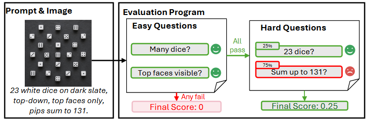
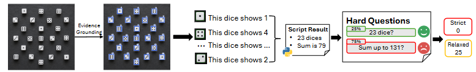
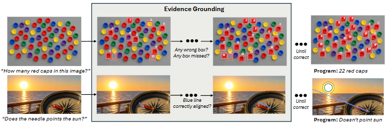
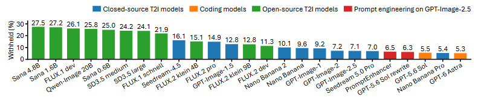

# GenOlympiad

[](https://genolympiad.github.io/)
[](https://arxiv.org/abs/2610.26850)
[](https://huggingface.co/datasets/XavierHugh/GenOlympiad-images)

GenOlympiad is a benchmark of 801 hard text prompts for text-to-image models. Each task has a prompt and an evaluation program. The program asks a judge VLM easy and hard questions about the generated image, and it scores the answers with code. The tasks cover nine capability axes: text fidelity (83 tasks), counterfactual instruction following (95), symbolic systems (83), world-knowledge grounding (82), physical consistency (92), quantitative precision (87), spatial and 3-D reasoning (83), latent computation (109) and long-range consistency (87). The strict score of a task is 100 only when every hard question passes. The relaxed score is the weight sum of the hard questions that pass.

## News

[2026/10/09] GenOlympiad is released!

## Leaderboard

Two tables: the strict score and the relaxed score, from 0 to 100.

Overall is the mean over all scored tasks of a model.

Withheld tasks are not included when calculating scores for individual axes or the overall benchmark.

### Strict score

| Model                                         | Text | C-Fact | Symbol | World | Phys | Quant | Spatial | Latent | Long | Overall |
| --------------------------------------------- | ---- | ------ | ------ | ----- | ---- | ----- | ------- | ------ | ---- | ------- |
| **Coding Models**                       |      |        |        |       |      |       |         |        |      |         |
| GPT-6 Astra                                   | 65.4 | 38.4   | 45.5   | 27.5  | 25.6 | 40.8  | 26.7    | 58.4   | 30.0 | 40.5    |
| GPT-5.6 Sol                                   | 62.5 | 32.2   | 42.3   | 26.0  | 27.7 | 31.6  | 28.2    | 53.3   | 28.4 | 37.5    |
| **Prompt Engineering on GPT-Image-2.5** |      |        |        |       |      |       |         |        |      |         |
| GPT 5.6 Sol                                   | 62.2 | 33.0   | 30.4   | 17.8  | 25.0 | 24.3  | 12.5    | 55.8   | 27.2 | 33.0    |
| PromptEnhancer                                | 26.9 | 21.3   | 19.8   | 6.8   | 8.3  | 16.7  | 8.9     | 15.2   | 11.0 | 15.1    |
| **Closed-source T2I Models**            |      |        |        |       |      |       |         |        |      |         |
| Nano Banana Pro                               | 41.5 | 27.8   | 25.6   | 10.5  | 13.1 | 17.1  | 11.2    | 38.1   | 24.4 | 23.9    |
| GPT-Image-2.5                                 | 30.4 | 23.0   | 20.5   | 6.8   | 8.1  | 13.2  | 18.4    | 6.5    | 9.8  | 14.9    |
| Seedream 5.0 Pro                              | 19.0 | 24.1   | 18.9   | 2.5   | 13.8 | 10.4  | 9.9     | 20.8   | 13.7 | 15.1    |
| Nano Banana 2                                 | 19.5 | 13.4   | 6.6    | 13.9  | 8.9  | 6.8   | 8.1     | 16.2   | 15.9 | 12.4    |
| GPT-Image-2                                   | 20.8 | 14.0   | 17.5   | 5.4   | 6.1  | 5.2   | 10.1    | 5.6    | 8.8  | 10.2    |
| GPT-Image-1.5                                 | 10.1 | 10.1   | 6.2    | 2.9   | 3.2  | 5.6   | 10.7    | 2.9    | 3.5  | 6.0     |
| Nano Banana                                   | 7.8  | 5.9    | 7.6    | 4.1   | 6.3  | 1.3   | 5.5     | 8.7    | 1.3  | 5.5     |
| FLUX.2 pro                                    | 7.1  | 6.0    | 5.0    | 1.6   | 6.9  | 2.7   | 1.8     | 17.3   | 1.9  | 6.3     |
| GPT-Image-1                                   | 11.4 | 7.0    | 10.5   | 3.9   | 5.1  | 2.7   | 1.3     | 2.9    | 2.6  | 5.2     |
| Seedream-4.5                                  | 3.0  | 0.0    | 0.0    | 0.0   | 8.5  | 5.7   | 0.0     | 5.8    | 1.8  | 3.0     |
| **Open-source T2I Models**              |      |        |        |       |      |       |         |        |      |         |
| FLUX.2 dev                                    | 1.4  | 3.6    | 4.1    | 3.0   | 10.0 | 1.4   | 5.6     | 1.1    | 1.3  | 3.5     |
| FLUX.2 klein 9B                               | 0.0  | 2.5    | 2.8    | 3.1   | 10.1 | 2.7   | 2.7     | 2.0    | 0.0  | 2.9     |
| FLUX.2 klein 4B                               | 0.0  | 3.9    | 2.7    | 6.6   | 5.3  | 0.0   | 7.1     | 0.0    | 2.7  | 2.9     |
| FLUX.1 dev                                    | 1.7  | 2.9    | 3.2    | 5.8   | 7.4  | 3.3   | 3.3     | 3.6    | 0.0  | 3.5     |
| FLUX.1 schnell                                | 1.6  | 2.9    | 0.0    | 3.1   | 8.3  | 3.2   | 2.9     | 0.0    | 3.4  | 2.8     |
| Qwen-Image 20B                                | 0.0  | 0.0    | 1.5    | 6.2   | 7.8  | 3.1   | 1.6     | 0.0    | 1.6  | 2.2     |
| SD3.5 large                                   | 0.0  | 1.5    | 0.0    | 5.4   | 1.5  | 1.6   | 1.5     | 0.0    | 1.4  | 1.3     |
| SD3.5 medium                                  | 0.0  | 0.0    | 1.6    | 3.8   | 2.8  | 1.6   | 0.0     | 0.0    | 0.0  | 1.0     |
| Sana 4.8B                                     | 0.0  | 0.0    | 0.0    | 1.9   | 6.0  | 0.0   | 1.7     | 0.0    | 0.0  | 1.0     |
| Sana 0.6B                                     | 0.0  | 0.0    | 1.7    | 1.9   | 4.3  | 1.8   | 1.6     | 0.0    | 0.0  | 1.2     |
| Sana 1.6B                                     | 1.5  | 3.4    | 1.7    | 1.7   | 3.1  | 0.0   | 1.8     | 0.0    | 0.0  | 1.4     |

### Relaxed score

| Model                                         | Text | C-Fact | Symbol | World | Phys | Quant | Spatial | Latent | Long | Overall |
| --------------------------------------------- | ---- | ------ | ------ | ----- | ---- | ----- | ------- | ------ | ---- | ------- |
| **Coding Models**                       |      |        |        |       |      |       |         |        |      |         |
| GPT-6 Astra                                   | 74.1 | 50.2   | 56.4   | 46.9  | 43.0 | 54.0  | 48.3    | 73.7   | 53.1 | 56.1    |
| GPT-5.6 Sol                                   | 72.4 | 43.3   | 55.5   | 43.5  | 41.6 | 45.8  | 49.4    | 69.1   | 46.7 | 52.4    |
| **Prompt Engineering on GPT-Image-2.5** |      |        |        |       |      |       |         |        |      |         |
| GPT 5.6 Sol                                   | 71.7 | 48.7   | 44.7   | 36.2  | 39.4 | 40.8  | 34.3    | 72.3   | 43.2 | 48.9    |
| PromptEnhancer                                | 38.7 | 33.9   | 30.7   | 19.0  | 24.5 | 27.7  | 26.8    | 30.6   | 22.3 | 28.4    |
| **Closed-source T2I Models**            |      |        |        |       |      |       |         |        |      |         |
| Nano Banana Pro                               | 55.8 | 39.3   | 38.6   | 29.5  | 33.8 | 27.0  | 30.7    | 56.0   | 43.2 | 40.0    |
| GPT-Image-2.5                                 | 41.8 | 36.4   | 34.8   | 24.1  | 23.7 | 25.0  | 34.6    | 21.9   | 25.9 | 29.6    |
| Seedream 5.0 Pro                              | 30.8 | 36.0   | 32.7   | 16.6  | 30.8 | 20.7  | 23.7    | 34.7   | 26.6 | 28.4    |
| Nano Banana 2                                 | 28.5 | 27.3   | 18.4   | 27.0  | 23.0 | 18.3  | 20.9    | 32.5   | 29.3 | 25.4    |
| GPT-Image-2                                   | 32.8 | 26.7   | 29.6   | 17.2  | 20.3 | 17.3  | 24.9    | 18.2   | 25.1 | 23.4    |
| GPT-Image-1.5                                 | 19.8 | 19.9   | 12.9   | 15.1  | 15.7 | 15.0  | 19.3    | 12.5   | 12.7 | 15.8    |
| Nano Banana                                   | 13.5 | 16.0   | 18.5   | 14.3  | 21.6 | 6.0   | 12.0    | 18.6   | 15.0 | 15.3    |
| FLUX.2 pro                                    | 12.0 | 15.9   | 12.9   | 9.5   | 17.4 | 12.9  | 9.9     | 24.8   | 14.2 | 15.0    |
| GPT-Image-1                                   | 20.1 | 15.2   | 21.1   | 15.1  | 15.4 | 11.4  | 12.2    | 12.6   | 11.8 | 14.9    |
| Seedream-4.5                                  | 8.3  | 10.2   | 5.7    | 8.8   | 16.6 | 12.3  | 10.4    | 12.5   | 9.2  | 10.6    |
| **Open-source T2I Models**              |      |        |        |       |      |       |         |        |      |         |
| FLUX.2 dev                                    | 4.1  | 9.3    | 9.3    | 11.4  | 18.4 | 7.5   | 12.8    | 7.8    | 12.1 | 10.3    |
| FLUX.2 klein 9B                               | 4.2  | 9.2    | 8.8    | 11.0  | 19.0 | 8.4   | 10.5    | 6.6    | 9.7  | 9.6     |
| FLUX.2 klein 4B                               | 1.8  | 8.3    | 10.2   | 17.5  | 11.7 | 7.7   | 12.4    | 6.1    | 7.1  | 8.9     |
| FLUX.1 dev                                    | 2.2  | 6.7    | 6.5    | 11.3  | 15.1 | 9.7   | 6.1     | 6.6    | 4.8  | 7.7     |
| FLUX.1 schnell                                | 3.9  | 7.2    | 4.0    | 9.0   | 14.9 | 7.0   | 12.4    | 2.9    | 7.1  | 7.6     |
| Qwen-Image 20B                                | 1.5  | 2.2    | 4.5    | 11.0  | 13.1 | 7.1   | 7.4     | 2.7    | 5.3  | 5.7     |
| SD3.5 large                                   | 0.6  | 3.8    | 2.8    | 8.9   | 5.3  | 3.1   | 9.7     | 2.9    | 4.7  | 4.5     |
| SD3.5 medium                                  | 0.8  | 1.7    | 3.1    | 8.8   | 7.8  | 5.0   | 4.4     | 3.6    | 5.8  | 4.5     |
| Sana 4.8B                                     | 0.7  | 1.9    | 2.7    | 5.2   | 10.5 | 3.6   | 5.3     | 4.4    | 2.4  | 4.1     |
| Sana 0.6B                                     | 0.6  | 1.6    | 3.0    | 5.5   | 7.0  | 5.7   | 6.7     | 3.4    | 2.4  | 3.9     |
| Sana 1.6B                                     | 1.7  | 4.0    | 2.6    | 6.7   | 5.8  | 1.1   | 6.3     | 2.7    | 2.0  | 3.6     |

Text: text fidelity. C-Fact: counterfactual instruction following. Symbol: symbolic systems. World: world-knowledge grounding. Phys: physical consistency. Quant: quantitative precision. Spatial: spatial and 3-D reasoning. Latent: latent computation. Long: long-range consistency. Coding models write an HTML page that draws the image. The two prompt engineering entries rewrite each prompt before GPT-Image-2.5 draws it.

## Usage

Install the dependencies. Python 3.11 or 3.12 works.

```
pip install -r requirements.txt
```

Set the keys: Copy `.env.example` to `.env` and fill in the keys you have.

`GEMINI_API_KEY` is always needed, because the judge VLM is Gemini 2.5 Flash.

The image model needs its own key:
`OPENAI_API_KEY` for GPT Image, `ARK_API_KEY` for Seedream, `BFL_API_KEY` for FLUX, `OPENROUTER_API_KEY` for OpenRouter, or `LEONARDO_API_KEY` for Leonardo. The keys can also be set as environment variables.

Run a model on all 801 tasks. You can try `--limit 3` first to ensure your API is correctly set up, then run the full set.

```
python eval.py --model gpt-image-1.5 --limit 3
python eval.py --model gpt-image-1.5
```

The run makes one image per task, judges every image and writes the report to
`results/<model>/`. Print the report of a finished run again with:

```
python summarize.py results/<model>
```

Add `--tex row.tex` to also write the scores as one LaTeX table row in the paper's column order.

`python eval.py --help` lists every option.

### Evaluate your own model

There are two ways.

1. Export the prompts, make the images yourself, and judge them. Name each image as
   `<task_id>.png`.

   ```
   python eval.py --export-prompts prompts.jsonl
   python eval.py --model my-model --images my_images/
   ```
2. Describe your image API in a JSON file.

   Copy `backends/simple.json`, set `endpoint` to your server and run:

   ```
   python eval.py --model my-model --backend-config my_api.json
   ```

   The file says what eval.py sends for each task and where the image is in the reply:

   ```
   {
     "name": "a plain image API",
     "format": "simple",
     "endpoint": "http://127.0.0.1:8000/generate",
     "method": "POST",
     "headers": {"Authorization": "Bearer ${MY_CUSTOM_API_TOKEN}"},
     "request": {"prompt": "${PROMPT}", "width": "${WIDTH}", "height": "${HEIGHT}"},
     "response": {"image_base64": "image_base64", "image_url": "image_url"},
     "timeout": 420,
     "retries": 5
   }
   ```

   `${PROMPT}`, `${WIDTH}` and `${HEIGHT}` are filled from the task. `${MY_CUSTOM_API_TOKEN}` is filled from `.env`, so put the server's token there; leave it empty if the server needs no token, or paste the token in place of the placeholder. `response` names the reply field that holds the image, as base64 or as a URL; one of the two is enough. `backends/openai_compatible.json` is the same thing for an API that speaks the OpenAI images format.

Each line of `prompts.jsonl` has the task id, the capability axis, the prompt, the image size and the prompt length.

Our leaderboard did not cut prompt when the original prompt is longer than the context of model. If a prompt is longer than your model's context length, the task is not generated. Give the limit with `--context-length` and `--tokenizer`, or list the task ids with `--not-generated`. A task that is not generated gets no score. The report counts it and lists it.

## How scoring works

Each task has easy questions and hard questions. The judge VLM answers them for the generated image. The easy questions come first. If one fails, the task scores 0. Otherwise the hard questions are marked. Many hard questions need evidence grounding. The judge VLM draws helping lines or bounding boxes on the image, and a deterministic program computes the answer from them.



The strict score of a task is 100 when all hard questions pass, and 0 otherwise. The relaxed score is the weight sum of the hard questions that pass. A model's strict score is the share of its scored tasks that pass every hard question. Its relaxed score is the mean over its scored tasks.



The following picture shows how the evidence grounding works. A task is withheld when the judge VLM cannot ground the evidence. For example, an object is too small, or the text cannot be read. A withheld task gets no score. It is never counted as zero.



The withheld rate is the share of judged tasks that were withheld. Tasks that were not generated are counted separately. This is the withheld rate between different models:



## Citation

```
coming soon...
```
